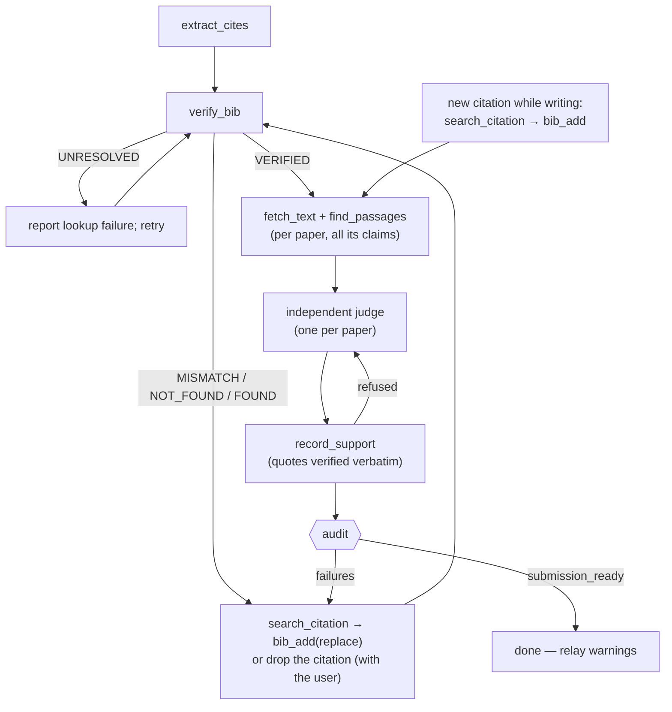

# Cite-Check: real papers, official BibTeX, supported claims

## Overview

An LLM-drafted bibliography fails in three ways, and this skill checks all
three with code rather than with confidence:

1. **Existence** — the paper must exist, and the identifier in the `.bib`
   must resolve to *that* paper. A real DOI attached to an invented title is
   the commonest fabrication and counts as one. Software is held to the same
   test: a GitHub URL must lead to a public repository whose name or
   declared title is the entry's, and a cited version must exist as a tag,
   branch or commit.
2. **Provenance** — BibTeX entries are fetched from the registry that owns
   the record (ADS, Crossref, DataCite, INSPIRE, arXiv) and stamped with a
   provenance comment. A repository with no DOI export gets an `@software`
   entry laid out by the toolbox from its authors' `CITATION.cff`, or from
   its GitHub record with the release or commit pinned. Nobody, human or
   model, types a `.bib` entry.
3. **Support** — for every citation instance, an independent judge reads
   the cited paper's text and returns a verdict backed by quotes that the
   tool checks are verbatim. A real paper cited for something it does not
   say is a fabrication too.

The enforcement lives in an MCP toolbox (`mcp/server.py`). Registry
lookups, title/author/year comparison, official export, quote verification
and the audit gate are computed there and returned as tool results; the
agent's job is to call them and act on what comes back.

This skill is **harness-agnostic**: it needs `<run-shell>` with Python 3.10+
and network access, file read/write, and — for the support check —
`<spawn-subagent>` or a disciplined second pass.

---

## Harness Adapter

| Capability | Claude Code | OpenAI Codex CLI | Google Antigravity | Fallback |
|---|---|---|---|---|
| toolbox tools | `mcp__cite-check__*` | server `cite-check` | server `cite-check` | CLI mode (below) |
| `<spawn-subagent>` (the judge) | `Agent`, `subagent_type: general-purpose` | `spawn_agent`, `fork_turns: "none"`; then `wait_agent` | `invoke_subagent`, `TypeName: "self"` | judge in a separate later pass, passages in front of you |
| `<run-shell>` | `Bash` | `exec_command` | `run_command` | — (required) |
| `<read-file>` / `<write-file>` | `Read` / `Write` / `Edit` | `apply_patch` / shell | `view_file` / `write_to_file` / `replace_file_content` | — (required) |

On Codex, `<run-shell>` runs in a sandbox with no network by default, so CLI
mode cannot reach the registries there; the MCP tools run outside it. If CLI
mode is all there is, rerun the failing call with escalated permissions (Codex
asks the user) — a registry that could not be reached is never a pass.

**Bootstrap (once per session, before the first citation task):**

1. Look for the tools in your tool list. Present → use them. Claude Code
   may list them by name only, as deferred tools: load them first
   (`ToolSearch`, `select:mcp__cite-check__ping`) before deciding they are
   absent.
2. Absent → run `bash <skill-dir>/mcp/setup_mcp.sh` via `<run-shell>`
   (idempotent: builds `mcp/.venv`, smoke-tests, registers the server in
   every harness found; tools appear at the **next** session start).
3. This session → CLI mode, same code:
   `<skill-dir>/mcp/.venv/bin/python <skill-dir>/mcp/server.py call <tool> '<json-args>'`
   (exit 0 = pass; 1 = fail/blocked; JSON verdict on stdout).
4. Call `ping`. No ADS token → say so once to the user (astronomy search
   and ADS exports are off; Crossref/arXiv/OpenAlex/INSPIRE still work). No
   GitHub token → repository checks still work, at 60 GitHub requests an
   hour (about 15 repositories); mention it only if one runs out. The
   installer asks for both, and `bash <skill-dir>/mcp/setup_mcp.sh --keys`
   asks again from a terminal, storing it in the OS keychain or a 0600 file
   (`references/registries.md` § Configuration). Never ask the user to
   paste a token into the chat, a config file, or a command line.

Never edit anything under `mcp/` during a task.

---

## Tools

| Tool | Does | Trust it for |
|---|---|---|
| `search_citation(title, author, year, hint, context, query)` | multi-registry search, duplicates merged, **ranked by cite-check's own scoring** (registry ranking is measurably wrong) | finding the real id of a paper you can describe; a `confidence: high` candidate |
| `resolve_citation(identifier \| [ids])` | arXiv / DOI / bibcode / OpenAlex / INSPIRE / GitHub repository → metadata + cross-linked ids; batched. A repository also returns `repo`: archived / fork / moved, CITATION.cff, `preferred_citation` (the paper its authors ask for), software DOI, README identifiers, and `ref` for a URL naming a tag / branch / commit | existence of an id; nothing more |
| `fetch_bibtex(identifier, key, prefer, journal_format, tex_path, version)` | official BibTeX from ADS → Crossref → DataCite → INSPIRE → arXiv → GitHub (first that has it), key rewritten, encoding-only cleanup | the only source of `.bib` text |
| `bib_add(bib_path, items, replace, tex_path)` | fetch + insert with `@comment{cite-check: …}` provenance; detects duplicates and key conflicts; `replace=true` swaps a hand-written entry for the official one | writing the `.bib` |
| `verify_bib(bib_path, keys, tex_path)` | per entry: resolve its own ids (DOI, arXiv, bibcode, else the GitHub repository in `url` / `howpublished` / `repository`), compare title / first author / year, check a cited `version`; entries without ids are searched | VERIFIED · FOUND · PROBABLE · MISMATCH · NOT_FOUND · UNRESOLVED |
| `lint_bib(bib_path, keys, verify)` | advisory metadata checks with exact entry locations; offline by default, optional own-identifier registry comparison | metadata review only; neither clean lint nor successful processing establishes identity, provenance, support or readiness |
| `verification_job(tex_path, bib_path, job_id, operation, budget, priorities, search_unresolved)` | prioritized registry checks with request/search/time/cost admission limits, persistent progress and an ordered support-work queue | identity progress only; remaining work is UNCHECKED and every job has `submission_ready=false` |
| `extract_cites(tex_path)` | manuscript citation occurrences, original claim/context and locations: TeX, Markdown/text key markers, or PDF page text; reports inline references and extraction uncertainty | observed support units; unknown citation scope is never a complete inventory |
| `register_input(tex_path, citations, reason)` | bind explicit numeric/author-year marker spans to bibliography keys in the current input snapshot | review mappings only; does not verify identity, official provenance or extraction completeness |
| `register_claims(tex_path, sentence_id, atoms)` | register a complete partition of exact sentence spans, explicit citation attachments, and declared uncited scope; derives stable atom IDs | no assertion or citation may disappear |
| `fetch_text(identifier, pdf_path, text_path, version)` | the paper's text: arXiv HTML → arXiv PDF → open-access PDF → abstract; a repository's README + description + CITATION.cff abstract; cached globally; `pdf_path=` for your own copy of a paywalled paper | `basis`: fulltext / readme / abstract / none |
| `find_passages(identifier, [claims], version)` | abstract + top passages per claim by content-word overlap | what the judge reads first |
| `record_support(workdir, key, claim, verdict, identifier, quotes, note, judge, context, version, tex_path, occurrence_id, atom_id, proposed_correction)` | stores a verdict **only** with verbatim quotes (SUPPORTS/PARTIAL/CONTRADICTS) or a note (UNSUPPORTED/UNVERIFIABLE); refuses UNVERIFIABLE when full text exists | the ledger cannot be narrated into a pass |
| `ledger_read(workdir)` | the manuscript's verdicts | resuming |
| `audit(tex_path, bib_path, require_support, verify, policy)` | separate existence/provenance/support coverage; default submission-ready gate or explicit exploratory progress; writes `.cite-check/audit.md` | only submission-ready policy plus `ok`, `input_complete`, `complete`, and `submission_ready` all true = done |
| `correction_report(tex_path, bib_path, policy, annotated, verify, require_support)` | runs a fresh audit and writes exact actionable findings to `.cite-check/corrections.json` / `.md`; optionally links an inert annotated HTML source copy | `report_written` means artifacts exist, never citation readiness; originals are unchanged |

Full argument lists are in each tool's docstring (`server.py call <tool>`
with bad args prints it). Registry behaviour and thresholds:
`references/registries.md`. Audit policy criteria and coverage fields:
`references/audit-policies.md`.

---

## Workflows

Pick the one that matches the request; all three end in `audit`.

`tex_path` remains the parameter name for backward compatibility and can
identify a `.tex`, `.md`, `.markdown`, `.txt` or `.pdf` manuscript. Read
`references/manuscript-inputs.md` before handling a non-TeX input or inline
`thebibliography`. Explicit Markdown/text citation keys can use the ordinary
atomic workflow; PDF, manually mapped and inline-reference inputs retain
their review limits. Never use a correct sidecar bibliography to silently
certify a different reference printed in the original document.

For a large manuscript or an explicit resource limit, use `verification_job`
to check consequential claims' citation identities first and resume within
fresh per-run grants. Priorities are scheduling advice; every low-priority
requirement stays visible. Source reading and independent judgments remain
pending, and the ordinary strict audit is still required. Read
`references/verification-jobs.md` for budget accounting and resume rules.

For bibliography metadata review, call `lint_bib` and relay its advisory
issues separately from citation verdicts. Missing fields, date concerns and
possible publication updates are review prompts, not permission to hand-edit
an official export. `verify=true` requests optional registry comparison;
unexpanded macros, inherited fields and unresolved comparisons stay explicit.
Read `references/bibliography-lint.md`. The ordinary audit remains required.

### A. Add a citation while writing

1. `search_citation` with what you know — best is `title`; else
   `hint="Smith2019"` plus the sentence as `context`; a pasted DOI/arXiv id
   is resolved directly. Read the candidates: take a `high`; ask the user
   about a `medium` (show title, year, venue, id); never take a `low`.
2. `bib_add(bib_path, items=[{"identifier": <id>, "key": <key>}], tex_path=…)`.
   `duplicate` → cite `existing_key`. `no-official-bibtex` → do not cite it;
   tell the user.
3. Write the sentence with `\cite{<key>}` (natbib/biblatex variant as the
   document uses).
4. Support-check that instance (Workflow C) before the passage is called
   done. Batch when several citations were added.

**Software.** A pasted GitHub URL goes straight to `resolve_citation`; a
package you can only name is found with
`search_citation(title=<name>, registries=["github"])` (opt-in, never a
default registry). Then read the result's `repo` before citing:

- `preferred_citation` set → the authors ask for that paper. Add it with
  `bib_add` by its id, and cite the repository as well only if the
  manuscript cites software separately (AAS journals ask for both).
- `fork` → cite the upstream (`parent`) unless the fork is the work used.
  `moved_from` → the old URL redirects; the entry gets the new one.
- Name the version that was used: pass `key` and, after `bib_add`, the
  entry carries the `version` (release tag, CITATION.cff version) or the
  pinned commit the toolbox found. Do not type a different version in.

### B. Verify an existing manuscript

1. `extract_cites(main.tex)` → keys, instances, `.bib` files.
2. `verify_bib(bib, keys=<cited keys>, tex_path=main.tex)`. Investigate
   MISMATCH / NOT_FOUND entries: identify the intended work with
   `search_citation`, then replace through `bib_add(…, replace=true)` or
   remove the citation with the user. UNRESOLVED means the lookup did not
   establish an answer (for example, rate limiting, an outage, or a malformed
   registry response). Keep it blocked, report the reason, and retry; do not
   call it fabricated or remove it on that basis. FOUND entries (no
   identifier in the entry) get replaced with the official one.
3. Support pass (Workflow C) over every missing or stale ledger verdict.
4. `audit(main.tex, policy="submission-ready")`. Require explicit readiness
   and complete current inputs/assessments; exploratory `ok` is not done. Relay `failures` and `warnings` to the user verbatim
   from the report; do not soften them.

### C. Support check (the judge)

Protocol and judge prompt: `references/support.md`. In short:

1. Inspect each extracted sentence for multiple assertions. Propose atomic
   spans with `register_claims` before judging a compound sentence; preserve
   all words, math, citation markers and their original scope. Use explicit
   uncited spans with a reason for the authors' own assertions; these remain
   unverified and visible in audit. Read `references/support.md` for offsets
   and attachment rules. Once atomic mode starts, register every current
   citation sentence (one span for a simple assertion); this prevents moved
   or edited claims silently losing their atomic checks. Group attached
   atoms/instances `by_key`.
   For each cited paper: `fetch_text(id)`
   (`pdf_path=` for paywalled ones the user has), then
   `find_passages(id, [every claim citing it])`. If the bibliography pins a
   version, pass that same `version` (or versioned identifier) to both tools
   and to `record_support`; never substitute the latest text. An official
   arXiv export that omits the requested version is refused, not repaired
   by hand or silently cited without its pin.
2. Spawn **one independent judge per paper** with the title, abstract,
   passages and the claims — never the manuscript's argument. Without
   `<spawn-subagent>`, judge in a separate pass after all writing is done,
   passages in front of you, and record `judge: "inline"`.
3. `record_support` per attached atom/occurrence with `tex_path`,
   `occurrence_id`, and registered `atom_id` (omit atom_id only for an
   undecomposed sentence outside atomic mode). Always pass the exact original extracted `claim`
   and `context`, the judge's verdict, verbatim quotes and note. The judge
   must see the full original sentence/context alongside each exact atom;
   support for one atom cannot cover another. Changed claims,
   context, source snapshots or evidence policies require a fresh judgment;
   legacy ledger records without those bindings are stale. A refusal (quote
   not found, note missing) goes back to the judge with the tool's reason;
   the writer does not "fix" the quote.
4. Verdicts: SUPPORTS · PARTIAL · UNSUPPORTED · CONTRADICTS · UNVERIFIABLE.
   UNSUPPORTED and CONTRADICTS fail the audit; the fix is a different paper,
   a weaker sentence, or no citation — decided with the user.

For failures, use `correction_report(..., annotated=true)` to produce a
reviewable copy with exact assertions, context, locations, evidence and next
actions. The independent judge may supply optional `proposed_correction`
with a non-support verdict; it is an unapproved draft, never an automatic
edit or a verified replacement. Read `references/correction-reports.md`
for the schema, freshness rules and correction workflow.

### Called by another skill

co-writer and co-scientist delegate all citation work here; the contract
(what they call, what `ok` means, what they must not do) is
`references/integration.md`.

---

## Hard Gates

<HARD-GATE>
A BibTeX entry enters a `.bib` only through `bib_add` (or `fetch_bibtex`
pasted unchanged except for its key). Never compose, complete, "fix up" or
paraphrase an entry — not the title, not the authors, not the year, not the
DOI, not a repository's version. If no registry exports one, the work is
not cited from this tool; say so. (`source=citation-cff` and
`source=github` entries are laid out by the toolbox from the repository's
own files and record; they obey the same rule.)
</HARD-GATE>

<HARD-GATE>
An identifier that did not come from `search_citation` / `resolve_citation`
in this session is not cited. Model memory of a DOI, arXiv id or bibcode is
a search query, not a citation.
</HARD-GATE>

<HARD-GATE>
A manuscript is not reported as citation-clean until `audit` with
`policy="submission-ready"`, `verify=true`, and `require_support=true`
returns literal true for `ok`, `input_complete`, `complete`, and
`submission_ready`. Exploratory progress never establishes readiness.
Verdicts come from the judge via
`record_support`; the writer never records its own.
</HARD-GATE>

---

## Anti-Patterns (each one was measured, see `references/registries.md`)

- **"The API returned something."** Crossref returns 177 000 hits for a
  nonsense title; ADS `link_gateway/…/ABSTRACT` 302-redirects for a
  fabricated bibcode. Existence means title similarity ≥ 0.9 against the
  record the entry's own identifier resolves to. `verify_bib` does this;
  a bare `resolve_citation: true` does not.
- **Trusting the registry's first hit.** Crossref and OpenAlex both rank a
  fraudulent republication of *Attention Is All You Need* above the real
  paper. Read the candidate list, not position one.
- **Checking only entries that have identifiers.** A third of a real
  astronomy `.bib` carries no DOI or arXiv id, and those are the recent,
  highest-risk papers. `verify_bib` searches them; FOUND means "replace
  with the official entry", not "fine".
- **"It compiles."** BibTeX happily builds a PDF with undefined citations
  and fabricated entries. `audit` checks the key sets and the registry, not
  the log.
- **Paraphrased evidence.** A quote the tool cannot find in the paper is
  not evidence. Quote the paper; if it does not say it, the verdict is not
  SUPPORTS.
- **Self-grading.** The agent that chose the citation must not be the one
  that judges whether the paper supports it.
- **Ignoring strength.** "shows" cited to a paper that "suggests" is
  PARTIAL. Judge the sentence as written.
- **Hand-typing months, journals, author lists** to make an export "look
  right". `fetch_bibtex` already normalises encoding; anything else changes
  the record.
- **"The GitHub link opens."** A repository can be real and still be the
  wrong citation: a fork, a renamed repository, a repository whose authors
  ask for a paper instead, a different project with a similar name, or a
  version that was never tagged. `verify_bib` checks each; a URL that loads
  checks none of them.
- **Citing the repository for what the code does.** `fetch_text` gives the
  judge the README, not the source. A claim the documentation does not make
  ("uses a KD-tree", "is GPU-accelerated") is UNVERIFIABLE from the
  repository; cite the paper or the documentation page that says it.

---

## Reference Index

Load on demand:

- `references/registries.md` — each registry's coverage, endpoints, auth,
  measured failure modes, matching thresholds, GitHub repositories,
  caching, configuration (`ADS_API_TOKEN`, `GITHUB_TOKEN`,
  `CITE_CHECK_MAILTO`, `CITE_CHECK_CACHE`)
- `references/support.md` — the claim-support protocol: units, verdict
  rubric, quote rules, judge independence, judge prompt template, efficiency
- `references/integration.md` — contract for co-writer / co-scientist and
  any other caller
- `mcp/server.py` — the toolbox; `mcp/setup_mcp.sh` — idempotent
  per-harness registration; `tests/verify_mcp.sh [--network]` — smoke tests
  on a fixture manuscript with one real-DOI-wrong-title entry, one
  identifier-less real paper, and two fabrications, plus a software `.bib`
  (a real repository, a paper filed under its repository's URL, a wrong
  repository, an invented version, a deleted repository)

## Process Flow

